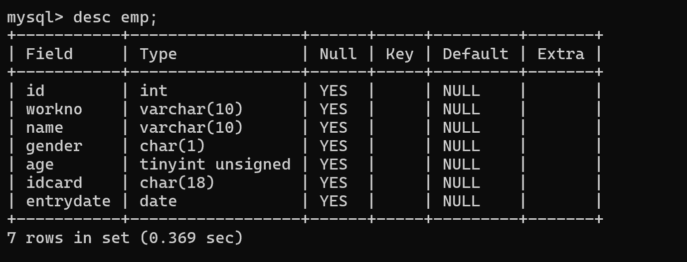
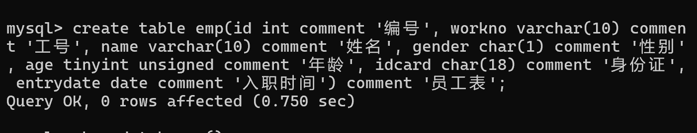
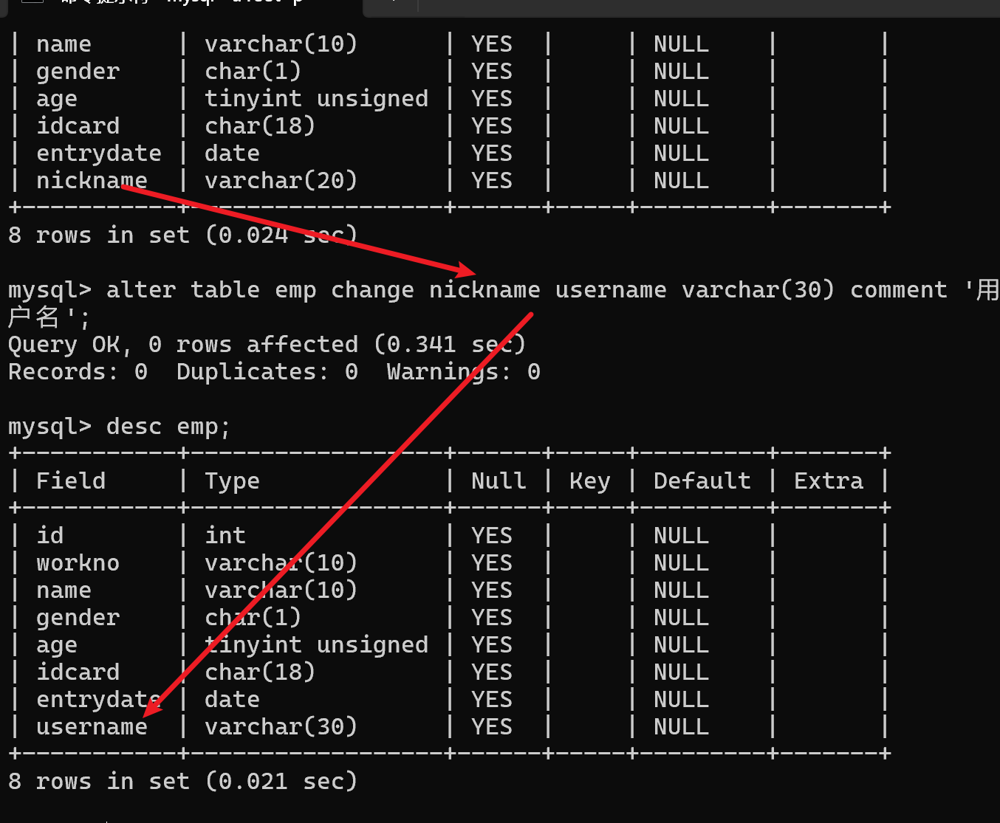
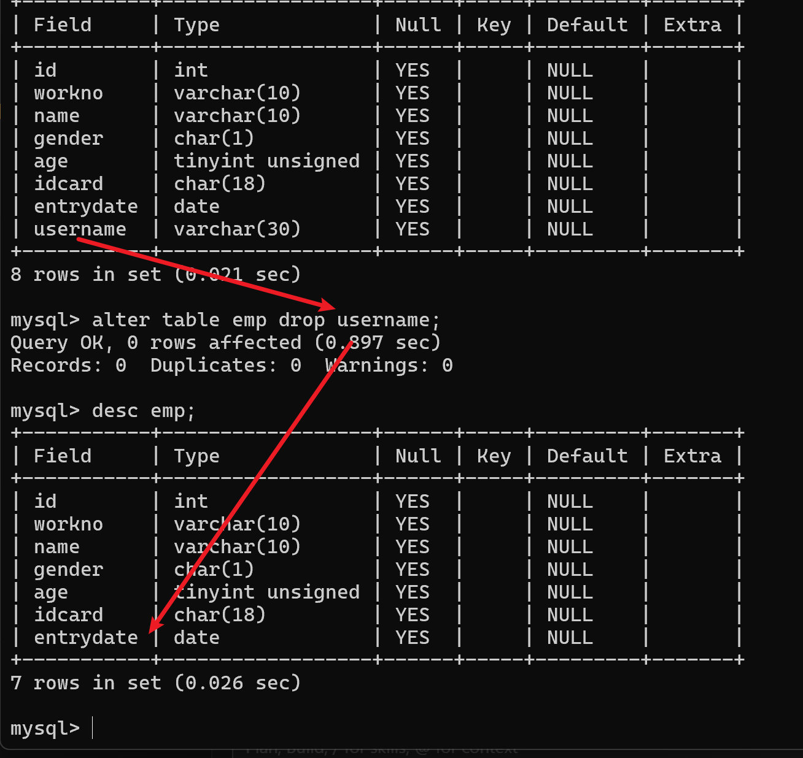

# 02 · SQL

## 目标

掌握建库建表与增删改查，能在 `demo` 上完成一轮 CRUD 与分组查询。

## SQL 通用语法

1. SQL 语句可以单行或多行书写，**以分号** `;` **结尾**
2. 可以使用空格 / 缩进增强可读性
3. MySQL 的 SQL **不区分大小写**；关键字建议使用大写（如 `SELECT`、`FROM`）
4. 注释：
   - 单行注释：`-- 注释内容` 或 `# 注释内容`（`#` 为 MySQL 特有）  
   - 多行注释：`/* 注释内容 */`

```sql
-- 单行注释
# 也是单行注释（MySQL）

/*
  多行注释
  可以写多行说明
*/

SELECT id, name
FROM customer
WHERE id = 1;   -- 语句以分号结束
```

## SQL 分类

| 分类 | 全称 | 含义 | 典型用途 |
|------|------|------|----------|
| **DDL** | Data Definition Language | 数据定义语言 | 定义数据库对象（数据库、表、字段等） |
| **DML** | Data Manipulation Language | 数据操作语言 | 对表中数据做增、删、改 |
| **DQL** | Data Query Language | 数据查询语言 | 查询表中的记录 |
| **DCL** | Data Control Language | 数据控制语言 | 创建用户、控制访问权限 |

对应常用语句（后文展开）：

- **DDL**：`CREATE` / `ALTER` / `DROP`  
- **DML**：`INSERT` / `UPDATE` / `DELETE`  
- **DQL**：`SELECT`  
- **DCL**：`GRANT` / `REVOKE`（本章以 DDL/DML/DQL 为主）

> 另有 **TCL**（事务控制：`COMMIT` / `ROLLBACK`），见 [06-事务](./06-事务.md)。

## 大纲

### 1. 建库与建表（DDL）

- `CREATE DATABASE` / `USE` / `DROP DATABASE`  
- `CREATE TABLE`：列名、类型、可空  
- `ALTER TABLE`、`DROP TABLE`（慎用）
- 查询
  - 查询所有数据库： SHOW DATABASES；
  - 查询当前数据库： SELECT DATABASES();
- 创建
  - CREATE DATABASES [IF NOT EXSTS] 数据库名 [DEFAULT CHARSET 字符集] [COLLATE 排序规则]
- 删除 
  - DROP DATABASES [IF EXISTS] 数据库名
- 使用
  - USE 数据库名

#### 常用数据类型

入门优先记：`INT`、`DECIMAL`、`VARCHAR`、`DATE` / `DATETIME`、`BOOLEAN`。

**1. 数值型**

| 类型 | 说明 |
|------|------|
| `TINYINT` / `SMALLINT` / `INT` / `BIGINT` | 整数，范围从小到大 |
| `DECIMAL(M,D)` | 精确小数，适合金额 |
| `FLOAT` / `DOUBLE` | 浮点数，有精度误差，金额慎用 |

**2. 字符串型**

| 类型 | 说明 |
|------|------|
| `CHAR(n)` | 定长，不足补空格 |
| `VARCHAR(n)` | 变长，最常用 |
| `TEXT` / `BLOB` | 大文本 / 二进制 |

**3. 日期时间型**

| 类型 | 说明 |
|------|------|
| `DATE` | 日期，如 `2026-11-10` |
| `TIME` | 时间 |
| `DATETIME` | 日期 + 时间 |
| `TIMESTAMP` | 时间戳（受时区影响） |

**4. 布尔型**

| 类型 | 说明 |
|------|------|
| `BOOLEAN` / `BOOL` | 实质是 `TINYINT(1)`，`0` 假、`1` 真 |

建表示例：

```sql
CREATE TABLE student (
  id INT,
  name VARCHAR(50),
  score DECIMAL(5,2),
  birthday DATE,
  created_at DATETIME,
  is_active BOOLEAN
);
```
```sql
show databases;
CREATE DATABASE IF NOT EXISTS ittest;
USE ittest;

CREATE TABLE emp (
  id INT COMMENT '编号',
  workno VARCHAR(10) COMMENT '工号',
  name VARCHAR(10) COMMENT '姓名',
  gender CHAR(1) COMMENT '性别',
  age TINYINT UNSIGNED COMMENT '年龄',
  idcard CHAR(18) COMMENT '身份证',
  entrydate DATE COMMENT '入职时间'
) COMMENT '员工表';

-- 查看表结构
DESC emp;

-- 查看当前库
SELECT DATABASE();
```

查看表结构结果：



查看当前库结果：



#### DDL · 表操作 · 修改

**添加字段**

```sql
ALTER TABLE 表名 ADD 字段名 类型(长度) [COMMENT 注释] [约束];

-- 示例
ALTER TABLE emp ADD nickname VARCHAR(20) COMMENT '昵称';
```

**修改数据类型**

```sql
ALTER TABLE 表名 MODIFY 字段名 新数据类型(长度);
```

**修改字段名和字段类型**

```sql
ALTER TABLE 表名 CHANGE 旧字段名 新字段名 类型(长度) [COMMENT 注释] [约束];

-- 示例
ALTER TABLE emp CHANGE nickname username VARCHAR(30) COMMENT '用户名';
```



**删除字段**

```sql
ALTER TABLE 表名 DROP 字段名;

-- 示例
ALTER TABLE emp DROP username;
```



**修改表名**

```sql
ALTER TABLE 表名 RENAME TO 新表名;

-- 示例
ALTER TABLE emp RENAME TO employee;

-- 查看表
SHOW TABLES;
```

#### DDL · 表操作 · 删除

**删除表**

```sql
DROP TABLE [IF EXISTS] 表名;
```

**清空表（删除数据后重建空表）**

```sql
TRUNCATE TABLE 表名;
```

> 注意：删除 / 清空表时，表中的全部数据也会被删除。

### 2. 插入、更新、删除（DML）

- `INSERT INTO ... VALUES` / 多行插入  
- `UPDATE ... SET ... WHERE`（强调 WHERE）  
- `DELETE FROM ... WHERE` vs `TRUNCATE`（概念对比）

### 3. 条件查询（DQL 基础）

- `SELECT` 列、别名、`DISTINCT`  
- `WHERE`：比较、`AND`/`OR`、`IN`、`BETWEEN`、`LIKE`、`IS NULL`  
- `ORDER BY`、`LIMIT`（及 MySQL 中 `LIMIT offset, count`）

### 4. 分组与聚合

- `COUNT` / `SUM` / `AVG` / `MAX` / `MIN`  
- `GROUP BY`  
- `HAVING` vs `WHERE`（过滤时机）

### 5. 基础子查询

- `WHERE` 中的单行 / 多行子查询（`IN` / `EXISTS` 入门）  
- 从句中的派生表（简单示例）

### 6. CRUD 闭环

- 在业务表上走通：查 → 增 → 改 → 再查 → 删（或事务内回滚）

## 示例（占位 · 依赖 demo）

```sql
USE demo;

-- 查询
SELECT id, name FROM customer WHERE id <= 3 ORDER BY id;

-- 分组
SELECT customer_id, COUNT(*) AS order_cnt
FROM orders
GROUP BY customer_id
HAVING COUNT(*) >= 1;
```

## 小结

- 语句以 `;` 结束；关键字建议大写；善用注释与缩进  
- DDL 管结构，DML 管数据，DQL 管查询，DCL 管权限  
- 改删必须带好 `WHERE`；分组后过滤用 `HAVING`  
- 子查询先会读、会写简单的，复杂场景多表章再展开

## 常见坑 / 面试点

- `DELETE` 无 `WHERE` 会清空表；生产需权限与备份意识  
- `WHERE` 里对列使用函数可能导致无法走索引（概念级）  
- `NULL` 不能用 `=` / `!=` 判断，用 `IS NULL` / `IS NOT NULL`  
- `LIMIT` 深分页性能问题（点到为止，细节留进阶）
