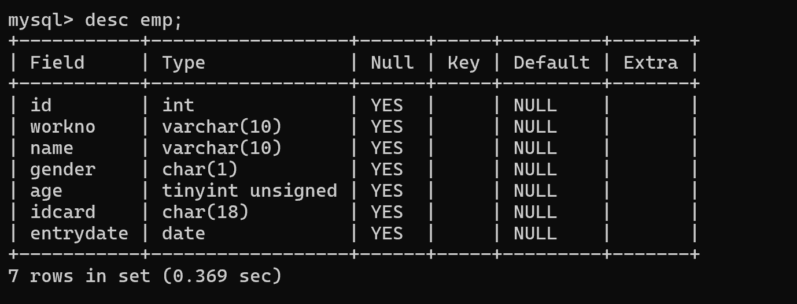
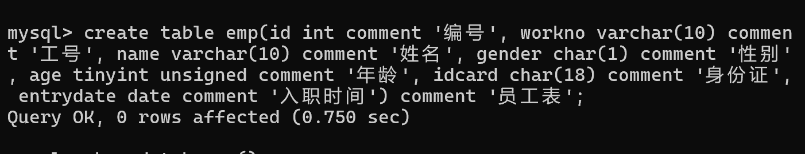
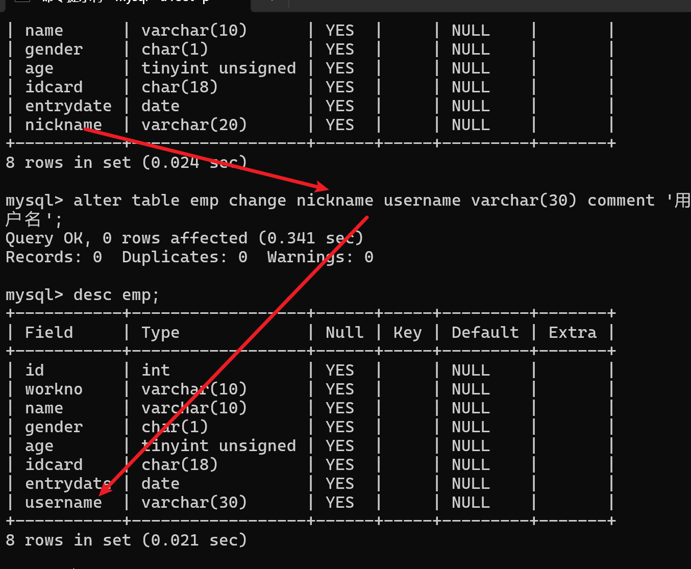
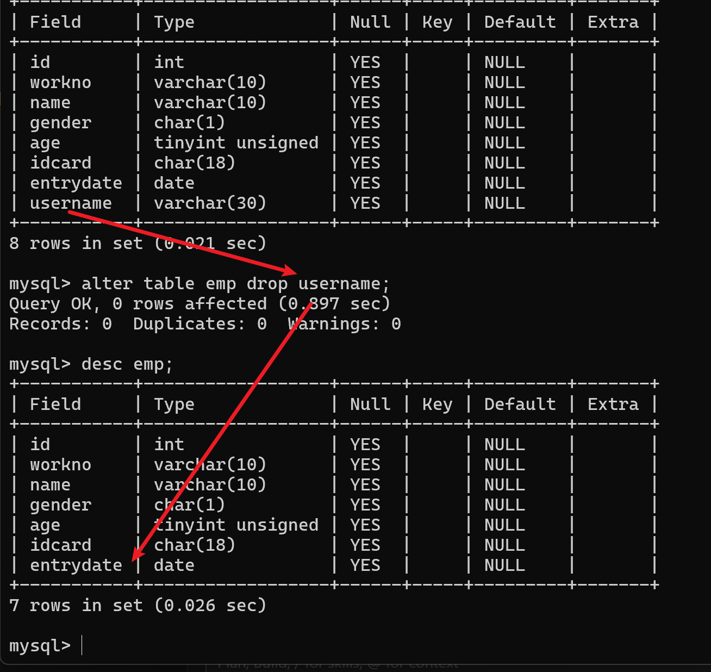
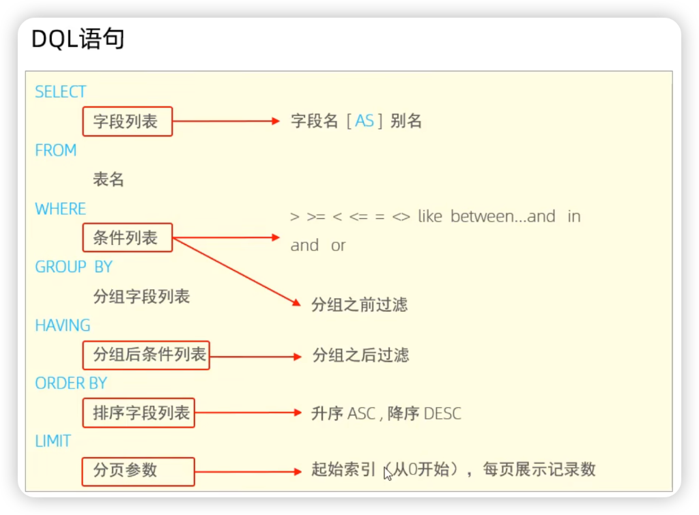
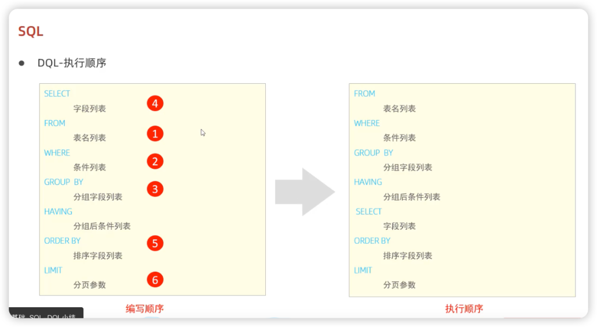
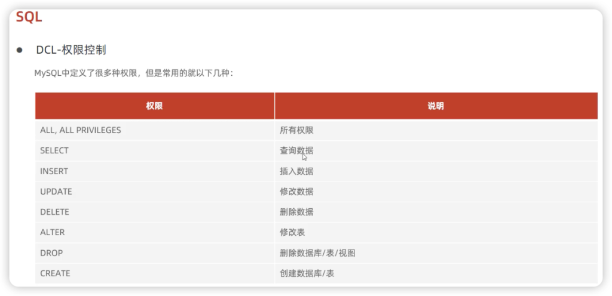

# 02 · SQL

## 目标

掌握建库建表与增删改查，能在 `demo` 上完成一轮 CRUD 与分组查询。

## SQL 通用语法

1. SQL 语句可以单行或多行书写，**以分号** `;` **结尾**
2. 可以使用空格 / 缩进增强可读性
3. MySQL 的 SQL **不区分大小写**；关键字建议使用大写（如 `SELECT`、`FROM`）
4. 注释：
   - 单行注释：`-- 注释内容` 或 `# 注释内容`（`#` 为 MySQL 特有）  
   - 多行注释：`/* 注释内容 */`

```sql
-- 单行注释
# 也是单行注释（MySQL）

/*
  多行注释
  可以写多行说明
*/

SELECT id, name
FROM customer
WHERE id = 1;   -- 语句以分号结束
```

## SQL 分类

| 分类 | 全称 | 含义 | 典型用途 |
|------|------|------|----------|
| **DDL** | Data Definition Language | 数据定义语言 | 定义数据库对象（数据库、表、字段等） |
| **DML** | Data Manipulation Language | 数据操作语言 | 对表中数据做增、删、改 |
| **DQL** | Data Query Language | 数据查询语言 | 查询表中的记录 |
| **DCL** | Data Control Language | 数据控制语言 | 创建用户、控制访问权限 |

对应常用语句（后文展开）：

- **DDL**：`CREATE` / `ALTER` / `DROP`  
- **DML**：`INSERT` / `UPDATE` / `DELETE`  
- **DQL**：`SELECT`  
- **DCL**：管理用户、`GRANT` / `REVOKE`（见后文「DCL · 管理用户」）

> 另有 **TCL**（事务控制：`COMMIT` / `ROLLBACK`），见 [06-事务](./06-事务.md)。

## 大纲

### 1. 建库与建表（DDL）

- `CREATE DATABASE` / `USE` / `DROP DATABASE`  
- `CREATE TABLE`：列名、类型、可空  
- `ALTER TABLE`、`DROP TABLE`（慎用）
- 查询
  - 查询所有数据库： SHOW DATABASES；
  - 查询当前数据库： SELECT DATABASES();
- 创建
  - CREATE DATABASES [IF NOT EXSTS] 数据库名 [DEFAULT CHARSET 字符集] [COLLATE 排序规则]
- 删除 
  - DROP DATABASES [IF EXISTS] 数据库名
- 使用
  - USE 数据库名

#### 常用数据类型

入门优先记：`INT`、`DECIMAL`、`VARCHAR`、`DATE` / `DATETIME`、`BOOLEAN`。

**1. 数值型**

| 类型 | 说明 |
|------|------|
| `TINYINT` / `SMALLINT` / `INT` / `BIGINT` | 整数，范围从小到大 |
| `DECIMAL(M,D)` | 精确小数，适合金额 |
| `FLOAT` / `DOUBLE` | 浮点数，有精度误差，金额慎用 |

**2. 字符串型**

| 类型 | 说明 |
|------|------|
| `CHAR(n)` | 定长，不足补空格 |
| `VARCHAR(n)` | 变长，最常用 |
| `TEXT` / `BLOB` | 大文本 / 二进制 |

**3. 日期时间型**

| 类型 | 说明 |
|------|------|
| `DATE` | 日期，如 `2026-11-10` |
| `TIME` | 时间 |
| `DATETIME` | 日期 + 时间 |
| `TIMESTAMP` | 时间戳（受时区影响） |

**4. 布尔型**

| 类型 | 说明 |
|------|------|
| `BOOLEAN` / `BOOL` | 实质是 `TINYINT(1)`，`0` 假、`1` 真 |

建表示例：

```sql
CREATE TABLE student (
  id INT,
  name VARCHAR(50),
  score DECIMAL(5,2),
  birthday DATE,
  created_at DATETIME,
  is_active BOOLEAN
);
```

```sql
show databases;
CREATE DATABASE IF NOT EXISTS ittest;
USE ittest;

CREATE TABLE emp (
  id INT COMMENT '编号',
  workno VARCHAR(10) COMMENT '工号',
  name VARCHAR(10) COMMENT '姓名',
  gender CHAR(1) COMMENT '性别',
  age TINYINT UNSIGNED COMMENT '年龄',
  idcard CHAR(18) COMMENT '身份证',
  entrydate DATE COMMENT '入职时间'
) COMMENT '员工表';

-- 查看表结构
DESC emp;

-- 查看当前库
SELECT DATABASE();
```

查看表结构结果：



查看当前库结果：



#### DDL · 表操作 · 修改

**添加字段**

```sql
ALTER TABLE 表名 ADD 字段名 类型(长度) [COMMENT 注释] [约束];

-- 示例
ALTER TABLE emp ADD nickname VARCHAR(20) COMMENT '昵称';
```

**修改数据类型**

```sql
ALTER TABLE 表名 MODIFY 字段名 新数据类型(长度);
```

**修改字段名和字段类型**

```sql
ALTER TABLE 表名 CHANGE 旧字段名 新字段名 类型(长度) [COMMENT 注释] [约束];

-- 示例
ALTER TABLE emp CHANGE nickname username VARCHAR(30) COMMENT '用户名';
```



**删除字段**

```sql
ALTER TABLE 表名 DROP 字段名;

-- 示例
ALTER TABLE emp DROP username;
```



**修改表名**

```sql
ALTER TABLE 表名 RENAME TO 新表名;

-- 示例
ALTER TABLE emp RENAME TO employee;

-- 查看表
SHOW TABLES;
```

#### DDL · 表操作 · 删除

**删除表**

```sql
DROP TABLE [IF EXISTS] 表名;
```

**清空表（删除数据后重建空表）**

```sql
TRUNCATE TABLE 表名;
```

> 注意：删除 / 清空表时，表中的全部数据也会被删除。

### 2. 插入、更新、删除（DML）

**给指定字段添加数据**

```sql
INSERT INTO 表名 (字段1, 字段2, ...) VALUES (值1, 值2, ...);
```

**给全部字段添加数据**

```sql
INSERT INTO 表名 VALUES (值1, 值2, ...);
```

**批量添加数据**

```sql
-- 指定字段
INSERT INTO 表名 (字段名1, 字段名2, ...)
VALUES (值1, 值2, ...), (值1, 值2, ...), (值1, 值2, ...);

-- 全部字段
INSERT INTO 表名
VALUES (值1, 值2, ...), (值1, 值2, ...), (值1, 值2, ...);
```

注意：

- 指定字段的顺序须与值的顺序一一对应
- 字符串和日期数据应放在引号中
- 插入的数据大小应在字段规定范围内

**修改数据**

```sql
UPDATE 表名 SET 字段名1 = 值1, 字段名2 = 值2, ... [WHERE 条件];
```

注意：

- `WHERE` 条件可有可无；没有条件时会修改整张表的所有数据

**删除数据**

```sql
DELETE FROM 表名 [WHERE 条件];
```

注意：

- `WHERE` 条件可有可无；没有条件时会删除整张表的所有数据
- `DELETE` 不能删除某一个字段的值（可用 `UPDATE` 将该字段设为 `NULL`）
- 对比：`DELETE` 删数据，`TRUNCATE` 清空并重建空表（见上文 DDL）

### 3. 条件查询（DQL 基础）

DQL（Data Query Language，数据查询语言）用来查询表中的记录，实际工作中使用频率高。核心关键字：`SELECT`。

**语法**

```sql
SELECT 字段列表
FROM 表名列表
WHERE 条件列表
GROUP BY 分组字段列表
HAVING 分组后条件列表
ORDER BY 排序字段列表
LIMIT 分页参数;
```



| 子句 | 参数 | 说明 |
|------|------|------|
| `SELECT` | 字段列表 | 字段名 `[AS]` 别名 |
| `FROM` | 表名 | 查询的数据来源 |
| `WHERE` | 条件列表 | 比较：`>` `>=` `<` `<=` `=` `<>` `LIKE` `BETWEEN ... AND` `IN`；逻辑：`AND` `OR`；**分组之前过滤** |
| `GROUP BY` | 分组字段列表 | 按指定字段分组 |
| `HAVING` | 分组后条件列表 | **分组之后过滤** |
| `ORDER BY` | 排序字段列表 | 升序 `ASC`，降序 `DESC` |
| `LIMIT` | 分页参数 | 起始索引（从 `0` 开始），每页展示记录数 |

#### DQL 执行顺序

编写顺序 ≠ 执行顺序：写的时候 `SELECT` 在最前，真正执行时 `FROM` 最先、`SELECT` 较后、`LIMIT` 最后。



| 步骤 | 编写顺序 | 执行顺序 |
|------|----------|----------|
| 1 | `SELECT` 字段列表 | `FROM` 表名列表 |
| 2 | `FROM` 表名列表 | `WHERE` 条件列表 |
| 3 | `WHERE` 条件列表 | `GROUP BY` 分组字段列表 |
| 4 | `GROUP BY` 分组字段列表 | `HAVING` 分组后条件列表 |
| 5 | `HAVING` 分组后条件列表 | `SELECT` 字段列表 |
| 6 | `ORDER BY` 排序字段列表 | `ORDER BY` 排序字段列表 |
| 7 | `LIMIT` 分页参数 | `LIMIT` 分页参数 |

查询分为：基本查询、条件查询（`WHERE`）、聚合查询、分组查询（`GROUP BY`）、排序查询（`ORDER BY`）、分页查询（`LIMIT`）。

#### 基本查询

**查询字段**

```sql
SELECT 字段1, 字段2, 字段3, ... FROM 表名;
SELECT age FROM employee;
SELECT * FROM 表名;   -- 查询全部列
```

**设置别名**

```sql
SELECT 字段1 [AS 别名1], 字段2 [别名2], ... FROM 表名;
SELECT age AS '年龄' FROM employee;
```

**去除重复记录**

```sql
SELECT DISTINCT 字段列表 FROM 表名;
SELECT DISTINCT age AS '年龄' FROM employee;
```

#### 条件查询（WHERE）

```sql
SELECT 字段列表 FROM 表名 WHERE 条件列表;
```

**比较运算符**

| 运算符 | 功能 |
|--------|------|
| `>` | 大于 |
| `>=` | 大于等于 |
| `<` | 小于 |
| `<=` | 小于等于 |
| `=` | 等于 |
| `<>` 或 `!=` | 不等于 |
| `BETWEEN ... AND ...` | 在某个范围内（含最小、最大值） |
| `IN (...)` | 在列表中多选一 |
| `LIKE` | 模糊匹配 |
| `IS NULL` | 是 `NULL` |

`LIKE` 占位符：

- `_`：匹配单个字符（如查 3 个字：`LIKE '___'`）
- `%`：匹配任意个字符（如以 X 结尾：`LIKE '%X'`）

**逻辑运算符**

| 运算符 | 功能 |
|--------|------|
| `AND` 或 `&&` | 并且（多个条件同时成立） |
| `OR` 或 `\|\|` | 或者（多个条件任一成立） |
| `NOT` 或 `!` | 非，取反 |

#### 其他查询类型

- 聚合 / 分组：见下节

#### 排序查询（ORDER BY）

**语法**

```sql
SELECT 字段列表 FROM 表名 ORDER BY 字段1 排序方式1, 字段2 排序方式2;
```

排序方式：`ASC` 升序（默认）、`DESC` 降序。

注意：多字段排序时，仅当第一个字段值相同时，才按第二个字段排序。

**示例**

```sql
-- 1. 按年龄升序 / 降序（不写 ASC/DESC 时默认升序）
SELECT * FROM emp ORDER BY age ASC;
SELECT * FROM emp ORDER BY age DESC;
SELECT * FROM emp ORDER BY age;

-- 2. 先按年龄升序，年龄相同再按入职时间降序 / 升序
SELECT * FROM emp ORDER BY age ASC, entrydate DESC;
SELECT * FROM emp ORDER BY age ASC, entrydate ASC;
```

#### 分页查询（LIMIT）

**语法**

```sql
SELECT 字段列表 FROM 表名 LIMIT 起始索引, 查询记录数;
```

注意：

- 起始索引从 `0` 开始；公式：`起始索引 = (页码 - 1) * 每页记录数`
- 分页是数据库方言，MySQL 使用 `LIMIT`
- 查第一页时可省略起始索引，简写为 `LIMIT 10`

**示例**

```sql
-- 1. 第 1 页，每页 10 条
SELECT * FROM emp LIMIT 0, 10;
SELECT * FROM emp LIMIT 10;   -- 等价简写

-- 2. 第 2 页，每页 10 条（起始索引 = 1 * 10 = 10）
SELECT * FROM emp LIMIT 10, 10;
```

### 4. 分组与聚合

#### 聚合查询

将一列数据作为一个整体，进行纵向计算。

**语法**

```sql
SELECT 聚合函数(字段) FROM 表名;
```

| 函数      | 功能   | 示例                                                   |
| ------- | ---- | ---------------------------------------------------- |
| `COUNT` | 统计数量 | `SELECT COUNT(idcard) FROM emp; 统计改企业员工数量`           |
| `MAX`   | 最大值  | `SELECT MAX(age) FROM emp;该企业最大年龄`                   |
| `MIN`   | 最小值  | `SELECT MIN(age) FROM emp;`                          |
| `AVG`   | 平均值  | `SELECT AVG(age) FROM emp; 统计平均年龄`                   |
| `SUM`   | 求和   | `SELECT SUM(age) FROM emp WHERE workaddress = '西安';` |

#### 分组查询（GROUP BY）

**语法**

```sql
SELECT 字段列表
FROM 表名
[WHERE 条件]
GROUP BY 分组字段名
[HAVING 分组后过滤条件];
```

**示例**

```sql
-- 1. 按性别分组，统计男女员工数量
SELECT gender, COUNT(*) FROM emp GROUP BY gender;

-- 2. 按性别分组，统计男女员工平均年龄
SELECT gender, AVG(age) FROM emp GROUP BY gender;

-- 3. 年龄 < 45，按工作地址分组，取员工数 >= 3 的地址
SELECT workaddress, COUNT(*)
FROM emp
WHERE age < 45
GROUP BY workaddress
HAVING COUNT(*) >= 3;
```

`WHERE` **与** `HAVING` **区别**

| 对比点 | `WHERE` | `HAVING` |
|--------|---------|----------|
| 执行时机 | 分组**之前**过滤，不满足条件不参与分组 | 分组**之后**对结果过滤 |
| 判断条件 | **不能**对聚合函数判断 | **可以**对聚合函数判断 |

注意：

- 执行顺序：`WHERE` → 聚合函数 → `HAVING`
- 分组后，查询字段一般只写**聚合函数**和**分组字段**；查其他字段通常无意义

#### SQL 练习

**1. 查询年龄为 20、21、22、23 岁的女性员工信息**

```sql
SELECT * FROM emp WHERE gender = '女' AND age IN (20, 21, 22, 23);
```

**2. 查询性别为男，且年龄在 20–40 岁（含）以内、姓名为三个字的员工**

```sql
SELECT * FROM emp
WHERE gender = '男'
  AND age BETWEEN 20 AND 40
  AND name LIKE '___';
```

**3. 统计年龄小于 60 岁的男性员工和女性员工人数**

```sql
SELECT gender, COUNT(*) FROM emp WHERE age < 60 GROUP BY gender;
```

**4. 查询年龄 ≤ 35 岁员工的姓名和年龄；按年龄升序，年龄相同按入职时间降序**

```sql
SELECT name, age
FROM emp
WHERE age <= 35
ORDER BY age ASC, entrydate DESC;
```

**5. 查询性别为男、年龄在 20–40 岁（含）以内的前 5 名员工；按年龄升序，年龄相同按入职时间升序**

```sql
SELECT *
FROM emp
WHERE gender = '男' AND age BETWEEN 20 AND 40
ORDER BY age ASC, entrydate ASC
LIMIT 5;
```

### 5. 基础子查询

- `WHERE` 中的单行 / 多行子查询（`IN` / `EXISTS` 入门）  
- 从句中的派生表（简单示例）

### 6. CRUD 闭环

- 在业务表上走通：查 → 增 → 改 → 再查 → 删（或事务内回滚）

### 7. DCL · 管理用户

DCL 全称 **Data Control Language**（数据控制语言），用来管理数据库用户、控制访问权限。

#### 用户管理 vs 权限管理

三者关系：**DCL 是大类，用户管理管「人」，权限管理管「能干什么」**。

| 概念 | 管什么 | 典型语句 |
|------|--------|----------|
| **DCL** | 数据控制语言这一整类 | 用户 + 权限相关语句都属 DCL |
| **用户管理** | 账号本身：有没有这个用户、密码、从哪台主机登录 | `CREATE USER` / `ALTER USER` / `DROP USER` |
| **权限管理** | 这个用户对库 / 表能做什么 | `GRANT` / `REVOKE` / `SHOW GRANTS` |

流程：先 `CREATE USER` 建用户 → 再 `GRANT` 赋权 → 用 `SHOW GRANTS` 核对。只有用户、没有授权时，通常几乎什么都不能做；删用户会一并带走其权限。

一句话：**先建用户，再赋权；用户是身份，权限是能力。**

#### 查看用户

用户信息保存在系统库 `mysql` 的 `user` 表中：

```sql
USE mysql;
SELECT * FROM user;
```

#### 创建用户

```sql
CREATE USER '用户名'@'主机名' IDENTIFIED BY '密码';
```

- 主机名 `localhost`：仅本机可访问  
- 主机名 `%`：任意主机可访问  

#### 修改用户密码

```sql
ALTER USER '用户名'@'主机名' IDENTIFIED WITH mysql_native_password BY '新密码';
```

#### 删除用户

```sql
DROP USER '用户名'@'主机名';
```

#### 案例

```sql
-- 1. 创建用户 itcast，仅 localhost 可访问，密码 123456
CREATE USER 'itcast'@'localhost' IDENTIFIED BY '123456';

-- 2. 创建用户 heima，任意主机可访问，密码 123456
CREATE USER 'heima'@'%' IDENTIFIED BY '123456';

-- 3. 修改 heima 的密码为 1234
ALTER USER 'heima'@'%' IDENTIFIED WITH mysql_native_password BY '1234';

-- 4. 删除 itcast@localhost
DROP USER 'itcast'@'localhost';
```

#### 权限控制

MySQL 中定义了很多种权限，常用的如下：



| 权限 | 说明 |
|------|------|
| `ALL` / `ALL PRIVILEGES` | 所有权限 |
| `SELECT` | 查询数据 |
| `INSERT` | 插入数据 |
| `UPDATE` | 修改数据 |
| `DELETE` | 删除数据 |
| `ALTER` | 修改表 |
| `DROP` | 删除数据库 / 表 / 视图 |
| `CREATE` | 创建数据库 / 表 |

**查询权限**

```sql
SHOW GRANTS FOR '用户名'@'主机名';
```

**授予权限**

```sql
GRANT 权限列表 ON 数据库名.表名 TO '用户名'@'主机名';
```

**撤销权限**

```sql
REVOKE 权限列表 ON 数据库名.表名 FROM '用户名'@'主机名';
```

注意：

- 多个权限之间用逗号分隔
- 授权时，数据库名和表名可用 `*` 通配，表示所有

**案例**

```sql
-- 查询 heima 的权限
SHOW GRANTS FOR 'heima'@'%';

-- 授予权限：itcast 库下所有表的全部权限
GRANT ALL ON itcast.* TO 'heima'@'%';

-- 撤销权限
REVOKE ALL ON itcast.* FROM 'heima'@'%';
```

#### 实践中怎么用

实践里很少天天手写 `CREATE USER` / `GRANT`，但思路必须会：

- **开发本机**：多用 `root` 或一个本地开发账号，方便学习、调试。
- **测试 / 生产**：一人一号或一服务一号，遵循**最小权限**——应用账号通常只有业务库的 `SELECT` / `INSERT` / `UPDATE` / `DELETE`，没有 `DROP`、`CREATE USER`。
- **运维 / DBA**：才管建用户、改密、授权、回收；开发一般提工单，不直接动生产账号。

| 角色 | 常见权限 |
|------|----------|
| 应用服务账号 | 业务库读写（甚至只读从库） |
| 数据分析 / 报表 | 多为 `SELECT` |
| 运维 / DBA | 更高权限，甚至接近 `ALL` |
| 只读排查账号 | 仅 `SELECT`，避免误改数据 |

实操习惯：

1. 先 `CREATE USER`，再 `GRANT`，用 `SHOW GRANTS` 核对  
2. 生产偏好 `'user'@'具体IP或网段'`，少用 `'%'`（任意主机风险大）  
3. 离职、下线服务时 `REVOKE` 或 `DROP USER`，避免账号残留  
4. 密码、权限变更走流程；应用连库用配置中心 / 密钥，不写死在代码里  

学习阶段：在本机用 `itcast` / `heima` 练建用户、授权、查权限即可；真正上线时按上面最小权限来。

## 示例（占位 · 依赖 demo）

```sql
USE demo;

-- 查询
SELECT id, name FROM customer WHERE id <= 3 ORDER BY id;

-- 分组
SELECT customer_id, COUNT(*) AS order_cnt
FROM orders
GROUP BY customer_id
HAVING COUNT(*) >= 1;
```

## 小结

- 语句以 `;` 结束；关键字建议大写；善用注释与缩进  
- DDL 管结构，DML 管数据，DQL 管查询，DCL 管用户与权限  
- 改删必须带好 `WHERE`；分组后过滤用 `HAVING`  
- 子查询先会读、会写简单的，复杂场景多表章再展开  
- 用户格式为 `'用户名'@'主机名'`；`localhost` 仅本机，`%` 表示任意主机  
- 先建用户再赋权；生产遵循最小权限，少用 `'%'`

## 常见坑 / 面试点

- `DELETE` 无 `WHERE` 会清空表；生产需权限与备份意识  
- `WHERE` 里对列使用函数可能导致无法走索引（概念级）  
- `NULL` 不能用 `=` / `!=` 判断，用 `IS NULL` / `IS NOT NULL`  
- `LIMIT` 深分页性能问题（点到为止，细节留进阶）
